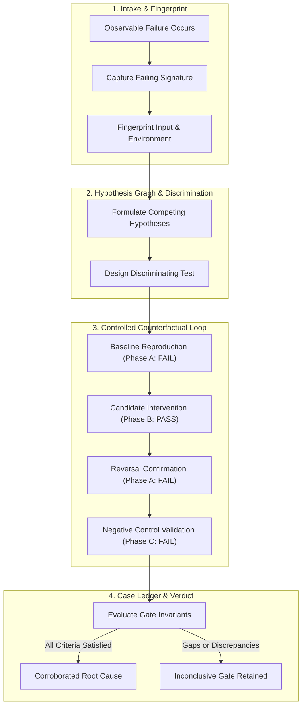

<div align="center">

# 🔍 Deep Digger

### Catch That Bug
**Evidence-Gated Root Cause Investigation • Controlled Falsification • Delta Minimization • Tamper-Evident Ledgers**

[](LICENSE)
[](https://bun.sh)
[](https://python.org)
[](https://rust-lang.org)
[](https://skills.sh)
[](https://claude.ai)
[](https://github.com/imMamdouhaboammar/deep-digger/actions)

<p align="center">
  <a href="#-executive-overview">Overview</a> •
  <a href="#-feature-matrix">Feature Matrix</a> •
  <a href="#-quickstart">Quickstart</a> •
  <a href="#-investigation-architecture">Architecture</a> •
  <a href="#-cli-reference">CLI Reference</a> •
  <a href="#-causal-claim-ladder">Claim Ladder</a> •
  <a href="#-attribution--provenance">Attribution</a>
</p>

</div>

---

## 📖 Executive Overview

Difficult software defects invite premature pattern-matching: an AI agent or engineer spots the first plausible stack trace, applies a speculative patch that hides symptoms, and marks the incident resolved—only for the defect to recur under load or in production.

**Deep Digger** (*Catch That Bug*) enforces scientific root-cause discovery for autonomous coding agents and software teams. It maintains competing causal hypotheses, mandates discriminating experiments that actively attempt falsification, preserves failed test runs, and validates root causes through strict four-phase counterfactual verification ($A \to B \to A \to C$).

---

## ⚡ Feature Matrix

| Capability | Traditional Ad-Hoc Debugging | Deep Digger Engine |
|---|---|---|
| **Hypothesis Tracking** | Single unverified hunch | Graph of competing falsifiable hypotheses |
| **Verification Pattern** | Single green test run | Full $A/B/A/C$ counterfactual receipt |
| **Flaky Defect Defense** | Ignored or retried until green | Repetition distribution & strict unresolved gate |
| **Failing Input Shrinking** | Manual trial-and-error | Algorithmic delta debugging (Python & zero-dependency Rust) |
| **Audit & Provenance** | Ephemeral console output | Tamper-evident SHA-256 JSON case ledger (`case.json`) |
| **Authority Boundaries** | Uncontrolled code mutation | Strict isolation: diagnosis separated from mutation |

---

## 🚀 Quickstart

### 1. Zero-Install Instant CLI

Run Deep Digger directly via Bun or Node without prior installation:

```bash
# Verify system dependencies
bunx deep-digger doctor
# or
npx deep-digger doctor

# Run case initialization
npx deep-digger init cases/incident-01
```

### 2. Universal Agent Skill Installation

Install Deep Digger into your AI agent harness (Claude Code, Antigravity, Gemini CLI, Cursor, Codex, OpenCode):

```bash
# Skills.sh / Vercel ecosystem
npx skills add imMamdouhaboammar/deep-digger

# Universal multi-agent one-liner (macOS & Linux)
curl -fsSL https://raw.githubusercontent.com/imMamdouhaboammar/deep-digger/main/install.sh | bash
```

Manual directory targets:
- **Claude Code**: `~/.claude/skills/deep-digger/`
- **Antigravity / Gemini CLI**: `~/.gemini/config/skills/deep-digger/`
- **Universal Agent Kernel**: `~/.agents/skills/deep-digger/`
- **Project Local**: `.agents/skills/deep-digger/`

---

## 📐 Investigation Architecture



---

## 🛠️ CLI Reference

The `deep-digger` CLI coordinates case files, evidence tracking, and delta minimization:

```bash
# 1. Initialize case folder
deep-digger init cases/cache-corruption

# 2. Register competing hypotheses
deep-digger hypothesis cases/cache-corruption add H1 "Cache key collision due to unescaped colon"
deep-digger hypothesis cases/cache-corruption add H2 "Eviction race during concurrent write bursts"

# 3. Attach verifiable evidence artifacts
deep-digger evidence cases/cache-corruption add E1 logs/failing-trace.log supports H1

# 4. Ingest OpenTelemetry, HAR, or JSON traces
deep-digger trace cases/cache-corruption --hypothesis H1 --file traces/otel-span.json

# 5. Link causal relations into a directed acyclic graph (DAG)
deep-digger link cases/cache-corruption --parent H1 --child H2 --relation causes

# 6. Evaluate empirical flakiness and measure P(FAIL)
deep-digger flake cases/cache-corruption --hypothesis H1 \
  --oracle "npm test -- tests/cache.test.ts" \
  --repeats 10 --allow-exec

# 7. Record controlled experiments (requires explicit --allow-exec)
deep-digger experiment cases/cache-corruption add H1 baseline \
  --oracle "npm test -- tests/cache.test.ts" \
  --allow-exec --repeat 2

deep-digger experiment cases/cache-corruption add H1 intervention \
  --oracle "npm test -- tests/cache.test.ts" \
  --allow-exec --repeat 2

# 8. Delta-debug minimal failing payload
deep-digger minimize ./payload.json \
  --oracle "python3 test_oracle.py" \
  --output ./minimal.json \
  --allow-exec

# 9. Generate causal status report
deep-digger report cases/cache-corruption --format text
```

---

## 🪜 Causal Claim Ladder

To eliminate speculation, all findings must adhere to the standardized claim ladder:

| Level | Evidence Requirement | Allowed Claim Language |
|---|---|---|
| **Observation** | Concrete error log, trace, or failing event | *"We observed..."* |
| **Reproduction** | Identical signature reproduced on clean baseline | *"The failure reproduces under..."* |
| **Candidate** | Mechanism hypothesized; initial experiments consistent | *"The leading candidate explanation is..."* |
| **Experimentally Corroborated** | Controlled $A/B/A/C$, mechanism verified, alternatives refuted | *"This root cause is corroborated within tested conditions..."* |
| **Inconclusive / Unresolved** | Contradictions, flaky oracle, missing permissions | *"Root cause unconfirmed because..."* |

---

## 🧪 Deterministic Verification & Testing

Every release of Deep Digger undergoes multi-tier automated verification:

```bash
# Verify system dependencies
bun bin/cli.js doctor

# Execute Python test suite (18 unit test cases)
python3 -m unittest discover -s evals -p 'test_cli.py' -v

# Execute Rust test suite (Unit & Integration)
cargo test --manifest-path rust/Cargo.toml
```

---

## 🛡️ Attribution & Provenance

- **Engineered by**: [Omni Skill](https://github.com/imMamdouhaboammar/omni-skill)
- **Author**: [Mamdouh Aboammar](https://github.com/imMamdouhaboammar)
- **Repository**: [https://github.com/imMamdouhaboammar/deep-digger](https://github.com/imMamdouhaboammar/deep-digger)
- **License**: MIT
